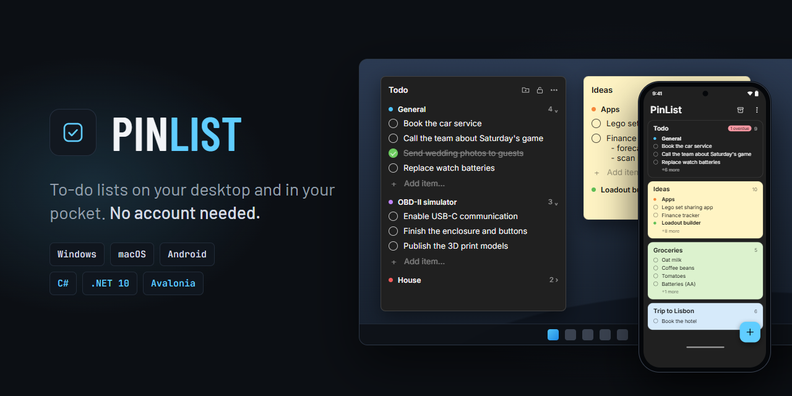

<p align="center">
  
</p>

# PinList

To-do list widgets pinned to your Windows desktop. Categories, drag-and-drop, due dates, reminders and an archive of completed items – no account, no cloud, everything stays on your PC.

---

## Features

- **Desktop widgets.** Each list is a borderless widget that stays on the desktop, survives **Win+D / Show desktop**, and isn't cluttering the taskbar or Alt+Tab.
- **As many widgets as you want.** Every widget remembers its position and size, and can be locked in place.
- **Categories.** Colored, collapsible and reorderable by drag-and-drop, also between widgets.
- **Fast editing.** Type and press Enter to add, double-click to edit, Shift+Enter for multi-line items.
- **Due dates and reminders.** Right-click an item to give it a due date or a reminder. Reminders show up as Windows notifications.
- **Archive.** Completed items are kept with the date and time they were completed; search, restore or delete them.
- **Undo.** Ctrl+Z undoes almost anything: deleting, completing, editing, renaming, moving, restoring.
- **Looks native on Windows 11.** Dark, light or pastel widgets, optional transparency, rounded menus that follow the Windows light/dark setting.
- **Your data is safe.** Every change is saved instantly to a local JSON file, with atomic writes and daily backups. Export and import your lists at any time.

## Requirements

- Windows 10 or 11 (x64)
- [.NET 10 Desktop Runtime](https://dotnet.microsoft.com/download/dotnet/10.0) (free, from Microsoft). If it's missing, Windows offers a download link the first time you start PinList.

## Download

Download `PinList.exe` from the [Releases](../../releases/latest) page.

PinList is a single exe – put it anywhere (e.g. `%LOCALAPPDATA%\Programs\PinList`) and run it. On first start it creates one widget and adds itself to *Start with Windows* (you can turn that off in the tray menu). Starting it again while it's running brings the widgets to the front.

> The exe isn't code-signed, so Windows SmartScreen may show *"Windows protected your PC"*. Click **More info → Run anyway**, or build it yourself from source.

To check that the download wasn't changed, compare its hash with `PinList.exe.sha256` from the same release:

```powershell
Get-FileHash .\PinList.exe -Algorithm SHA256
```

## Usage

| Action | How |
|---|---|
| Add an item | Type in **Add item…** and press **Enter**. Focus stays in the box for the next one. |
| Multi-line item | **Shift+Enter** starts a new line (when adding and when editing). |
| Complete an item | Click the circle. Click again within ~1 s to cancel. |
| Edit | Double-click the text. **Enter** saves, **Esc** cancels. |
| Due date / reminder | Right-click an item → **Add due date…** or **Add reminder…**. Overdue dates turn red, today's are highlighted. Reminders missed while PinList wasn't running are shown when it starts; clicking a reminder shows the item. |
| Delete | Click an item or category (it gets highlighted) and press **Delete**. Not archived. |
| Undo | **Ctrl+Z** undoes the last change – in any widget or in the archive (there is one undo history for the whole app, the last 50 changes). |
| Reorder | Drag an item or a category header – within a widget or to another one. The list scrolls when you drag near its edge. |
| New category | The folder button in the widget header. |
| Category options | Right-click a category header: rename, color, collapse, delete. |
| Rename a widget | Double-click its header. The title is optional – leave it empty for no title. |
| Widget color | **⋯ → Window color** and **⋯ → Transparent background**. |
| App theme | **⋯ → App theme** or the tray menu: *Use Windows setting* (default), *Light* or *Dark*. Applies to menus, dialogs and the archive. |
| Move / resize | Drag the header / drag the edges. The 🔒 button locks position and size. |
| Archive | **⋯ → Archive** or the tray menu. Enter or double-click restores, Delete removes permanently, Ctrl+Z undoes, Ctrl+F searches. |
| Export / import | **⋯ → Export…** saves all widgets and the archive to a file. **⋯ → Import…** either adds a file's widgets next to yours or replaces everything (a copy of your current lists is kept in `backups`). |
| Tray icon | Left-click brings all widgets to the front; right-click opens the menu (new window, archive, theme, export/import, start with Windows, data folder, exit). |

Widgets can't be closed with Alt+F4 by accident – use **⋯ → Delete window** to remove one.

## Keyboard and accessibility

Everything works without a mouse. To reach your widgets from the keyboard, press **Win+B** to get to the tray, select the PinList icon, press **Enter** to open its menu and choose **Show all windows** – or simply start PinList again. Keyboard focus lands on the first category.

| Key | In a widget |
|---|---|
| **Tab** / **Shift+Tab**, **↑** / **↓** | Move between the header buttons, categories, items and *Add item* boxes |
| **Space** | Complete the focused item (press again within ~1 s to cancel) |
| **Enter** or **F2** | Edit the item · on a category: **Enter** collapses/expands, **F2** renames |
| **Delete** | Delete the item or category (focus moves to the next one) |
| **Alt+↑** / **Alt+↓** | Move the item or category up or down (items move into the next category at the edges) |
| **Context menu key** or **Shift+F10** | Open the item's or category's menu (due date, reminder, color, …) |
| **Ctrl+Z** | Undo |
| **Ctrl+Arrows** / **Ctrl+Shift+Arrows** | Move / resize the widget (when it isn't locked) |

- **Screen readers** (Narrator, NVDA, JAWS): every button and field has a name, items are read with their due date and reminder (*"Renew passport, overdue, was due Sat 17 Oct"*), categories with their item count and whether they're collapsed, and dialogs with their title. Completing, deleting, moving, undoing and restoring are announced.
- **Contrast**: small grey text has at least 4.5:1 contrast (WCAG AA) on every widget color. With a Windows **contrast theme** turned on, PinList uses its colors everywhere.
- **Text size**: PinList follows **Settings → Accessibility → Text size**.
- **Visible focus**: the focused element gets a clear outline when you use the keyboard. Click targets such as the complete circle are at least 24 × 24 px.

## Where your data lives

Everything is stored in `%APPDATA%\PinList\`:

| File | Contents |
|---|---|
| `data.json` | All widgets, categories, items, positions, colors, settings and the archive |
| `backups\data-YYYY-MM-DD.json` | One backup per day, the last 7 are kept |
| `backups\before-import-….json` | Your lists as they were before an import replaced them |
| `data.vN.json` | A copy of the file from before PinList upgraded its format (or opened a file from a newer version) |
| `log.txt` | Errors, if any occur (older entries move to `log.old.txt` after 1 MB) |

`data.json` is written 300 ms after every change, using a temp file + replace, so a crash or power cut can't corrupt it. If the file is ever damaged, the latest backup is loaded automatically.

To move your lists to another PC, use **Export…** and **Import…**.

## Building from source

You need the [.NET 10 SDK](https://dotnet.microsoft.com/download/dotnet/10.0):

```powershell
winget install Microsoft.DotNet.SDK.10
```

Then:

```powershell
git clone https://github.com/FilipRaic/pin-list.git
cd pin-list
scripts\publish.bat
```

| Script | What it does |
|---|---|
| `scripts\run.bat` | Runs the app in Debug mode (`dotnet run`) while you're developing |
| `scripts\publish.bat` | Builds a Release exe into `publish\PinList.exe` and starts it |

Both scripts close a running PinList first, because only one instance can run at a time. Debug and Release builds share the same data in `%APPDATA%\PinList`.

To try something without touching your real lists, point PinList at another folder. Such a run doesn't change *Start with Windows* and can run next to your normal PinList:

```powershell
$env:PINLIST_DATA_DIR = "C:\Temp\pinlist-test"
dotnet run --project src\PinList\PinList.csproj
```

### Tests

`dotnet test PinList.sln` runs about 270 tests in roughly 15 seconds. They cover the data and undo logic, and also the real windows: the UI tests start the actual app on a **hidden Windows desktop**, so no window appears on your screen or takes your focus. They use their own data folder, a fake tray icon and scripted dialogs, and never touch your real lists or "Start with Windows". Keys, mouse and drag-and-drop are simulated through `Services/InputState.cs`.

To see coverage:

```powershell
dotnet test tests\PinList.Tests -p:CollectCoverage=true -p:ExcludeByFile=**/obj/**
```

CI fails if line coverage drops below 99 % or branch coverage below 92 %. The only code left out on purpose (`[ExcludeFromCodeCoverage]`) acts on Windows itself: the real tray icon, opening Explorer, ending the process, and the system drag loop.

Or use the .NET CLI directly:

```powershell
dotnet build PinList.sln
dotnet test PinList.sln
dotnet run --project src\PinList\PinList.csproj
```

The solution (`PinList.sln`) opens in Rider, Visual Studio or VS Code with the C# Dev Kit.

## Releasing a new version

Releases are built by GitHub Actions (`.github/workflows/release.yml`):

1. Update `<Version>` in `src/PinList/PinList.csproj` and add an entry to [CHANGELOG.md](CHANGELOG.md).
2. Commit and push to `master`.
3. Create and push a tag with the same version:
   ```powershell
   git tag v1.1.0
   git push origin v1.1.0
   ```
4. The workflow checks that the tag is on `master` and matches the csproj version, runs the tests, builds `PinList.exe`, and creates a GitHub release with the exe and its `PinList.exe.sha256` checksum attached. Edit the release notes on GitHub if needed.

Every push and pull request to `master` is also built (warnings count as errors) and tested by `.github/workflows/build.yml`, so a broken build shows up right away. Dependabot opens pull requests when the GitHub Actions or test packages have updates.

## Project structure

```
pin-list/
├─ .github/                CI (build + tests, releases) and Dependabot
├─ docs/                   README and social preview image
├─ scripts/                run.bat, publish.bat
├─ src/PinList/
│  ├─ App.xaml(.cs)        startup, single instance, tray icon, theme, reminders, export/import, shared styles
│  ├─ Assets/              app icon
│  ├─ Converters/          XAML value converters
│  ├─ Models/              Board → Category → TodoItem, ArchivedItem, Settings, AppData
│  ├─ Services/
│  │  ├─ Actions.cs        every data change (add, complete, delete, move, …) and undo
│  │  ├─ Store.cs          loading/saving data.json, format upgrades, backups, export/import, log
│  │  ├─ Reminders.cs      checks for due reminders
│  │  ├─ Screens.cs        monitor work areas, keeping widgets reachable
│  │  ├─ Themes.cs         widget, menu and archive colors (light and dark)
│  │  ├─ Native.cs         Win32: pin to desktop, tool window, title bar color
│  │  └─ Autostart.cs      start with Windows (HKCU\…\Run)
│  └─ Views/               BoardWindow (widget; split into core, menus, drag & drop),
│                          ArchiveWindow, ConfirmDialog, DateDialog
├─ tests/PinList.Tests/    xUnit tests for data changes, saving/loading and helpers
├─ CHANGELOG.md
├─ PinList.sln
└─ LICENSE
```

### How the desktop pinning works

Each widget is a borderless, transparent WPF window whose owner is the desktop window (`Progman`). Owned windows aren't hidden by *Show desktop*, and the `WS_EX_TOOLWINDOW` style keeps them out of the taskbar and Alt+Tab. If Explorer restarts, the widgets are recreated automatically.

### Changing the data format

`data.json` has a `version` number. When a change needs old files converted, add a step to `MigrationSteps` in `Store.cs` and raise `AppData.CurrentVersion`. Older files are upgraded on load (a copy of the original is kept), and there's a test for loading a version 1 file.

## License

[MIT](LICENSE)
