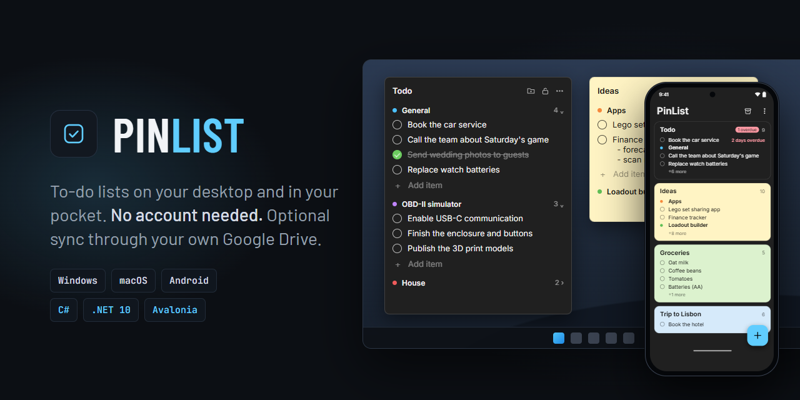

<p align="center">
  
</p>

# PinList

To-do lists pinned to your desktop – on **Windows** and **macOS** – and in your pocket on **Android**. Categories, drag-and-drop, due dates, reminders and an archive of completed items. No account needed. Optional sync through your own Google Drive.

**Website:** [filipraic.github.io/pin-list](https://filipraic.github.io/pin-list/)

---

## Features

- **Desktop widgets** (Windows and macOS). Each list is a borderless widget that stays on the desktop. On Windows it survives **Win+D / Show desktop** and stays out of the taskbar and Alt+Tab; on macOS it stays on the desktop (Space) where you put it, out of the Dock and Cmd+Tab (PinList shows in the Dock only while the PinList window is open), and never shows on top of an app in full screen.
- **Phone app** (Android). A bottom bar with **Lists**, **Archive** and **Settings**. Lists shows a card for every list with its color, item count, overdue items and a short preview that starts with the items due first. Tap one to open it full screen.
- **As many lists as you want.** Every widget remembers its position and size, and can be locked in place.
- **One PinList window** (Windows and macOS). A sidebar with **All lists**, **Archive** and **Settings**. All lists shows every list as a card, like the phone, and the cards can be dragged into any order (the order syncs). Each card has an **On desktop** switch, so a list can be a widget on one computer and not on another, and still be opened and edited there.
- **Copy items.** Copy one item, a category or a whole list as text, to paste it into a message or another app.
- **Categories.** Colored, collapsible and reorderable by drag-and-drop, also between widgets.
- **Fast editing.** Type and press Enter to add, double-click (tap on the phone) to edit, Shift+Enter for multi-line items.
- **Due dates and reminders.** A due date is a day: it shows on the item and turns red when it's overdue, saying how long (*3 days overdue*). A reminder is a day and time: it shows up once as a system notification (on the phone also when the app is closed) and is then removed. On Windows and macOS the notification stays on the screen until you dismiss it.
- **Archive.** Completed items are kept with the date and time they were completed, grouped by day. Search, restore or delete them.
- **Undo.** On the desktop, Ctrl+Z undoes almost anything: deleting, completing, editing, renaming, moving, restoring. On the phone, the bar that appears after a change has an *Undo* button.
- **One look everywhere.** The Inter font and the same colors, corners and icons on Windows, macOS and Android. Dark, light or pastel lists, optional transparency, menus that follow the system light/dark setting. Each category has its own color, shown as a readable shade on every list color.
- **Optional Google Drive sync.** Sign in with Google and choose which lists sync between your PCs, Macs and phone. Changes are merged item by item, also after days offline, and nothing you deleted comes back. Your lists go only to a hidden folder in **your own** Google Drive – see [Sync](#sync).
- **Update notices (optional).** On first start PinList asks whether it may check for new versions. If you say yes, it looks about once a day and tells you when one is out – see [Updating](#updating).
- **Feedback.** **Settings → Send feedback** opens the [feedback page](https://filipraic.github.io/pin-list/feedback) with your PinList version filled in. Send it by email (no account needed) or as a GitHub issue.
- **Your data is safe.** Every change is saved right away to a local JSON file, with atomic writes and daily backups. Export and import your lists at any time – also to move them between a PC, a Mac and a phone.

## Requirements

| | |
|---|---|
| **Windows** | Windows 10 or 11 (x64) and the [.NET 10 Desktop Runtime](https://dotnet.microsoft.com/download/dotnet/10.0) (free, from Microsoft). If it's missing, Windows offers a download link the first time you start PinList. |
| **macOS** | macOS 12 Monterey or newer, on a Mac with Apple Silicon (M1 or newer). Nothing else to install. |
| **Android** | Android 8.0 or newer. |

## Download

Get the files from the [website](https://filipraic.github.io/pin-list/#download) or the [Releases](../../releases/latest) page. Each one has a `.sha256` file next to it, to check that the download wasn't changed.

### Windows – `PinList.exe`

PinList is a single exe – put it anywhere (e.g. `%LOCALAPPDATA%\Programs\PinList`) and run it. On first start it opens the PinList window and adds itself to *Start with Windows* (you can turn that off in **Settings**). Starting it again while it's running brings the widgets to the front.

> The exe isn't code-signed, so Windows SmartScreen may show *"Windows protected your PC"*. Click **More info → Run anyway**, or build it yourself from source.

```powershell
Get-FileHash .\PinList.exe -Algorithm SHA256   # compare with PinList.exe.sha256
```

### macOS – `PinList.zip`

For Macs with Apple Silicon (M1 or newer), macOS 12 or newer. A Mac app is a folder, so it comes zipped.

1. Unzip it and move **PinList.app** to *Applications*.
2. The app isn't notarized by Apple (that needs a paid developer account), so macOS blocks it at first. Open **Terminal** and run:
   ```bash
   xattr -dr com.apple.quarantine /Applications/PinList.app
   ```
   Then open PinList normally. (Alternatively: try to open it once, then **System Settings → Privacy & Security → Open Anyway**.)
3. PinList lives in the **menu bar**, with a Dock icon only while the PinList window is open. On first start it opens the PinList window and adds itself to the login items. You can turn that off in **Settings**.
4. Allow notifications when PinList asks – reminders use them. Set the alert style to **Persistent** (**Alerts** before macOS 15) so a reminder stays until you close it, and **Show in Notification Center** on to find it there later. PinList's **Settings** tells you when one of them is off.
5. If you use Google sync, macOS may ask for your login password because *"PinList wants to use your confidential information stored in PinList in your keychain"*. This is your Google sign-in, which PinList keeps in the Keychain. Enter your password and click **Always Allow**. Since the app isn't signed with an Apple developer certificate, macOS sees each new version as a different app, so this comes back once after every update. If you click **Deny**, PinList can't read the sign-in and you have to sign in to Google again.

If macOS says the app *"is damaged"*, sign it for your Mac and try again:

```bash
codesign --force --deep --sign - /Applications/PinList.app
```

To check the download: `shasum -a 256 PinList.zip` and compare with `PinList.zip.sha256`.

### Android – `PinList.apk`

1. Download the APK on the phone (or copy it there) and open it.
2. Allow your browser or file manager to *install unknown apps* when Android asks.
3. Allow notifications when PinList asks – reminders need them.

On **Xiaomi / HyperOS** (and some other brands), the system may stop apps in the background, which can delay reminders. Open **Settings → Apps → PinList** and set **Battery saver → No restrictions** and turn on **Autostart**.

Updates install over the old version and keep your lists.

### Updating

On first start PinList asks whether it may check for updates. If you say yes, it asks GitHub about once a day for the number and the release notes of the latest release (nothing about you or your lists is sent, see the [privacy policy](https://filipraic.github.io/pin-list/privacy)). When a new version is out:

- **Everywhere:** PinList shows what's new in it once, with **Get it** and **Later**, and **Settings** gets a dot until you update.
- **Windows and macOS:** the tray / menu bar menu gets **Get PinList x.y.z** at the top, and **Settings → Check for updates** a **Get it** button. **Get it** downloads the new `PinList.exe` (Windows) or `PinList.zip` (Mac) in your browser. Replace the old one with it.
- **Android:** **Settings** gets **Get PinList x.y.z** at the top. **Get it** downloads the new `PinList.apk` in your browser. Open it to install it over the old version.

If a release doesn't have the file for your device, **Get it** opens the [Download](https://filipraic.github.io/pin-list/#download) section of the website instead.

If the check can't reach GitHub (no internet yet, GitHub down), it tries again when the network comes back (desktop) or when you open PinList again (phone).

Change your answer at any time with **Check for updates** in **Settings** (on the desktop and on the phone).

## Usage

### Desktop (Windows and macOS)

| Action | How |
|---|---|
| Add an item | Type in **Add item** and press **Enter**. Focus stays in the box for the next one. |
| Multi-line item | **Shift+Enter** starts a new line (when adding and when editing). |
| Complete an item | Click the circle. Click again within ~1 s to cancel. |
| Edit | Double-click the text. **Enter** saves, **Esc** cancels. |
| Due date / reminder | Right-click an item → **Add due date** or **Add reminder**. Pick a quick choice, or a day and a time. Overdue dates turn red and say how long they're overdue (*3 days overdue*), today's are highlighted. A reminder is a system notification that stays on the screen until you dismiss it. Clicking it (or **Show** on Windows) shows the item while PinList runs. On macOS this needs the alert style that stays (**Persistent** since macOS 15, **Alerts** before), which PinList asks for, and **Show in Notification Center** to keep it in the sidebar (System Settings → Notifications → PinList). macOS doesn't let an app change these, so when one is off, **Settings** shows a *Reminders* row that says what's off, with a button to that page. If notifications are off for PinList, it shows its own small window instead, which also stays until closed. A reminder is removed from the item once it rang. Reminders missed while PinList wasn't running are shown when it starts. |
| Delete | Click an item or category (it gets highlighted) and press **Delete**. PinList asks first (Ctrl+Z still brings it back). Not archived. Emptying an item's text deletes it too, after asking. |
| Undo | **Ctrl+Z** undoes the last change – in any widget or in the archive (one undo history for the whole app, the last 50 changes). |
| Reorder | Drag an item or a category header – within a widget or to another one. The list scrolls when you drag near its edge. |
| New category | The folder button in the widget header. |
| Category options | Right-click a category header: rename, color, collapse, copy items, delete. |
| Copy | Right-click an item → **Copy**, a category → **Copy items**, or **⋯ → Copy all items** for the whole list. One item per line with "- " in front, ready to paste anywhere. |
| All lists | **⋯ → All lists** or the tray / menu bar menu opens the PinList window on every list as a card. Click one to open and edit it, right-click for its menu, drag it to put the lists in another order (the order syncs to your other devices). Each card's preview starts with the items due first. The **On desktop** switch on each card shows or hides that list's widget on this computer. Lists still sync, whatever the switch says. **+ New list** at the end adds a list. With no lists it says *No lists yet, create one to get started*. |
| Remove a widget from the desktop | **⋯ → Remove from desktop**. The list stays in **All lists** and on your other devices. Ctrl+Z brings the widget back. |
| Rename a widget | Double-click its header. The title is optional – leave it empty for no title. |
| List color | **⋯ → List color** is a row of colors (use the arrow keys and Enter). **⋯ → Transparent** is a switch. |
| App theme | **Settings → Appearance**: *System* (default), *Light* or *Dark*. Applies to menus, dialogs and the PinList window. |
| Move / resize | Drag the header / drag the edges. The 🔒 button locks position and size. |
| Archive | **⋯ → Archive** or the tray / menu bar menu. Items are grouped by day. Enter or double-click restores, Delete removes permanently (after asking), Ctrl+Z undoes, Ctrl+F searches. The **Restore** and **Delete** buttons under the list act on the selected items, and the same buttons show on the row under the mouse. |
| Sync a list | **⋯ → Sync this list** (signs in with Google first if needed). See [Sync](#sync). |
| Export / import | **Settings → Your data → Export** saves all lists and the archive to a file. **Import** either adds a file's lists next to yours or replaces everything (a copy of your current lists is kept in `backups`). |
| Tray / menu bar icon | Brings all widgets to the front (or opens **All lists** when no list is a widget). Its menu has **All lists**, **New list**, **Archive**, **Show all widgets**, **Settings** and exit (*Quit PinList* on a Mac). |
| Settings | **⋯ → Settings** or the tray / menu bar menu. Appearance, Google Drive sync, start at login, check for updates, export, import, the data folder and **Send feedback**. |
| Updates | When a new version is out, PinList shows what's new in it, Settings gets a dot and the tray / menu bar menu starts with **Get PinList x.y.z**. See [Updating](#updating). |

Widgets can't be closed with Alt+F4 by accident. Use **⋯ → Remove from desktop** to hide one, or **⋯ → Delete list** to delete the list. Shutting down or restarting the computer closes PinList without asking.

### Phone (Android)

| Action | How |
|---|---|
| Open a list | Tap its card. **Back** returns to the cards. The bottom bar has **Lists**, **Archive** and **Settings**. |
| New list | The **New list** button on the Lists screen. |
| Add an item | Type in **Add item** and press Enter on the keyboard; the keyboard stays open for the next one. |
| Complete an item | Tap the circle (tap again quickly to cancel). |
| Edit | Tap the text of an item, or the list's title. |
| Menus | **Press and hold** a card, a category or an item: due date, reminder, move to another list, copy, color, rename, delete. A list's menu has a row of list colors and a **Sync this list** switch. Swipe a menu down to close it. |
| Reorder | Press and hold, then drag – cards on the first screen, items and categories in a list. Hold near the top or bottom edge to scroll. The order of the cards syncs. |
| Undo | The *Undo* button in the bar that appears after deleting, completing or moving. |
| Archive | The **Archive** tab. Completed items are grouped by day. Tap one to restore or delete it. |
| Theme, export / import, feedback | The **Settings** tab. |
| Google sync | **Settings → Google Drive sync** to sign in, then **press and hold** a card (or the list's ⋮ menu) → **Sync this list**. |
| Updates | **Settings → Check for updates** turns the update check on or off. When a new version is out, a sheet shows what's new in it, the Settings tab gets a dot and **Settings → Get PinList x.y.z** downloads it. |

## Sync

Sync is optional and off until you turn it on. It works between any mix of Windows PCs, Macs and Android phones signed in with the same Google account.

1. **Sign in.** Desktop and phone: **Settings → Google Drive sync → Sign in with Google** (your browser opens Google's sign-in page). Signing in doesn't sync anything yet.
2. **Choose lists.** Desktop: **⋯ → Sync this list**. Phone: press and hold a card → **Sync this list**. The list then appears on your other signed-in devices. Turning it off on any device turns it off everywhere, and every device keeps its copy as a normal local list.
3. **The icon** in a synced list's header shows how it's doing: a cloud with a check (up to date), turning arrows (syncing), a cloud with an arrow (offline – changes sync later), a red cloud (a problem – click or tap it for what to do). A crossed-out cloud means the list isn't synced. Signed out, there's no icon at all.

How it behaves:

- Changes reach your other devices within about 20 seconds while PinList runs. The **phone also syncs in the background, about every 15 minutes** (only with a network, and only while you're signed in with at least one synced list), so reminders set on the PC ring on the phone even if PinList is closed. On **Xiaomi / HyperOS** and some other brands, set **Settings → Apps → PinList → Battery saver → No restrictions** for that.
- Edits made on different devices, also offline, are merged item by item. If the same item was changed on two devices, the newer change wins. An item deleted on one device is deleted everywhere – unless it was edited on another device after that, then it stays.
- Deleting a synced list deletes it on all devices (PinList asks first and says so).
- **Sign out** keeps all lists on this device and pauses their sync. Your other devices stay signed in. **Sign out and delete cloud data** also removes PinList's data from your Google Drive and PinList's access to your Google account, which signs out every device; your lists stay on every device as local lists.
- The order of the lists syncs: drag a card in All lists (desktop) or Lists (phone) and the other devices follow. Each list keeps its place, so moving one list on one device and another list on another device both stay.
- Widget positions and sizes, the lock, the app theme and "start with Windows" are per device and never synced.

Privacy: PinList can only see its own hidden folder in your Drive, never your other files, and there is no PinList server. The full policy is on the [privacy page](https://filipraic.github.io/pin-list/privacy). Building your own release with sync needs your own Google project – see [Releasing a new version](#releasing-a-new-version).

## Keyboard and accessibility

Everything on the desktop works without a mouse. On Windows, press **Win+B** to get to the tray, select the PinList icon, press **Enter** to open its menu and choose **Show all widgets** – or simply start PinList again. Keyboard focus lands on the first category.

| Key | In a widget |
|---|---|
| **Tab** / **Shift+Tab**, **↑** / **↓** | Move between the header buttons, categories, items and *Add item* boxes |
| **Space** | Complete the focused item (press again within ~1 s to cancel) |
| **Enter** or **F2** | Edit the item · on a category: **Enter** collapses/expands, **F2** renames |
| **Delete** | Delete the item or category, after asking (focus moves to the next one) |
| **Alt+↑** / **Alt+↓** | Move the item or category up or down (items move into the next category at the edges) |
| **Context menu key** or **Shift+F10** | Open the item's or category's menu (due date, reminder, color, …) |
| **Ctrl+C** / **Ctrl+Shift+C** | Copy the focused item / its whole category. On a category, Ctrl+C copies its items |
| **Ctrl+Z** | Undo |
| **Ctrl+Arrows** / **Ctrl+Shift+Arrows** | Move / resize the widget (when it isn't locked) |

On a Mac, use **⌘** (Cmd) where the table says Ctrl (⌘Z, ⌘C, ⌘F), **Return** for Enter, **Option** for Alt and the **delete** key (⌫) to delete. Menus and the archive show the shortcuts with the Mac key symbols.

- **Screen readers** (tested with Narrator, NVDA and JAWS on Windows): every button and field has a name, items are read with their due date and reminder (*"Renew passport, 2 days overdue, was due Sat 17 Oct"*), categories with their item count and whether they're collapsed, and dialogs with their title. Completing, deleting, moving, undoing and restoring are announced.
- **Contrast**: small grey text has at least 4.5:1 contrast (WCAG AA) on every list color. With a Windows **contrast theme** turned on, PinList uses its colors everywhere.
- **Text size**: on Windows, PinList follows **Settings → Accessibility → Text size**.
- **Visible focus**: the focused element gets a clear outline when you use the keyboard. Click targets such as the complete circle are at least 24 × 24 px.

## Where your data lives

| | Folder |
|---|---|
| Windows | `%APPDATA%\PinList\` |
| macOS | `~/Library/Application Support/PinList/` |
| Android | The app's private storage (removed when the app is uninstalled – export first) |

| File | Contents |
|---|---|
| `data.json` | All lists, categories, items, positions, colors, settings and the archive |
| `backups/data-YYYY-MM-DD.json` | One backup per day, the last 7 are kept |
| `backups/before-import-….json` | Your lists as they were before an import replaced them |
| `data.vN.json` | A copy of a file from a newer version of PinList, kept before this version saves over it |
| `log.txt` | Errors, if any occur (older entries move to `log.old.txt` after 1 MB) |
| `sync-state.json` | Google sync's state: the signed-in account and which cloud files were merged (only after signing in) |
| `google-token.dat` | Windows: your Google sign-in, encrypted for your Windows user (macOS keeps it in the **Keychain**, Android in Google Play services). Removed when you sign out. |

`data.json` is written 300 ms after every change, using a temp file + replace, so a crash or power cut can't corrupt it. If the file is ever damaged, the latest backup is loaded automatically. The format is the same on every platform and is described on the [data format page](https://filipraic.github.io/pin-list/data-format).

On Windows, reminders tell Windows the name and icon of PinList's notifications under `HKEY_CURRENT_USER\Software\Classes\AppUserModelId\PinList`, and the icon is copied to `notification-icon.png` in the data folder. Nothing else is written outside the data folder except the **Start with Windows** entry.

To move your lists to another device, use **Export** and **Import**.

## Building from source

You need the [.NET 10 SDK](https://dotnet.microsoft.com/download/dotnet/10.0):

```powershell
winget install Microsoft.DotNet.SDK.10
```

Then, on Windows:

```powershell
git clone https://github.com/FilipRaic/pin-list.git
cd pin-list
scripts\publish.bat
```

| Script | What it does |
|---|---|
| `scripts\run.bat` | Runs the Windows app in Debug mode (`dotnet run`) while you're developing |
| `scripts\publish.bat` | Empties `publish\`, builds a Release exe into `publish\PinList.exe` and starts it |
| `scripts\publish-android.bat` | Builds the Android APK signed with the release key into `publish\android\PinList.apk`. Asks for the keystore password (hidden, never saved). Optional argument: the keystore path (default `pinlist.keystore` in the repo folder) |
| `scripts\publish-mac.bat` | On Windows: builds `PinList.app` for Apple Silicon into `publish\mac\PinList.zip`, like `package-mac.sh` but without the signature (that needs a Mac). After unzipping on the Mac, run `codesign --force --deep --sign - PinList.app && xattr -cr PinList.app` once |
| `scripts/package-mac.sh` | On a Mac: builds `PinList.app` and zips it (`bash scripts/package-mac.sh 2.2.0`) |

Both `.bat` scripts close a running PinList first, because only one instance can run at a time. Debug and Release builds share the same data.

`Directory.Build.props` keeps build folders small: native debug symbols are never copied, and a build without `-r` only gets the native libraries for its own system (Windows or macOS). A desktop build folder is about 90 MB.

**Android:** install the workload once with `dotnet workload install android` (it needs the Android SDK and a JDK – installing [Android Studio](https://developer.android.com/studio) gives you both). Then `dotnet build src/PinList.Android -c Release` makes `src/PinList.Android/bin/Release/net10.0-android/com.pinlist.app-Signed.apk` (signed with a debug key – see *Releasing* for the real one).

To try something without touching your real lists, point the desktop app at another folder. Such a run doesn't change *Start with Windows* and can run next to your normal PinList:

```powershell
$env:PINLIST_DATA_DIR = "C:\Temp\pinlist-test"
dotnet run --project src\PinList\PinList.csproj -f net10.0-windows10.0.19041.0
```

### Tests

`dotnet test PinList.Desktop.slnf` runs the two test projects (the filter leaves out the Android app, which needs the .NET Android workload. `PinList.sln` has everything):

- `tests/PinList.Core.Tests` – the data, undo, reminders and file format logic, and sync: the merge engine with simulated devices (offline for days, stale files, restored backups, three devices), the Drive client and the sign-in against fake HTTP. It runs on Windows, macOS and Linux (CI runs it on all three).
- `tests/PinList.Tests` – the real windows and the phone screens, run with Avalonia's **headless** platform: nothing appears on your screen, and keys, mouse, touch-and-hold and drag-and-drop are simulated. The tests use their own data folder, a fake tray icon and scripted dialogs, and never touch your real lists or "Start with Windows".

To see coverage:

```powershell
dotnet test PinList.Desktop.slnf -p:CollectCoverage=true -p:ExcludeByFile=**/obj/**%2c**/*.axaml
```

CI fails if line coverage drops below 99 % or branch coverage below 90 %. The only code left out on purpose (`[ExcludeFromCodeCoverage]`) acts on the operating system itself: Win32 and macOS window calls, the real tray icon, opening Explorer/Finder, the system file pickers, the on-screen keyboard and the few words that differ between Windows and macOS (`OsText`).

The solution (`PinList.sln`) opens in Rider, Visual Studio or VS Code with the C# Dev Kit.

## Releasing a new version

Releases are built by GitHub Actions (`.github/workflows/release.yml`):

1. Update `<Version>` in [`Version.props`](Version.props) – the one version for every app (Android's version code follows from it) – and add a `## [x.y.z] - date` section to [CHANGELOG.md](CHANGELOG.md) – it becomes the release notes.
2. Commit, tag the commit with the same version and push both (they can go together):
   ```powershell
   git tag v2.7.1
   git push origin master v2.7.1
   ```
3. The release workflow checks that the tag is on `master`, matches `Version.props` and has a CHANGELOG section. Then it **waits for the Build workflow of that commit** (tests, coverage, all three apps) and stops if it failed, so nothing is published from a broken commit. After that it builds `PinList.exe`, `PinList.zip` and `PinList.apk` and creates a GitHub release with all three, their `.sha256` checksums and the version's CHANGELOG section as release notes.
4. If the Build failed: when it failed by chance, re-run it, then **Re-run failed jobs** on the release (the tag stays). When it needs a fix, commit the fix and move the tag to it:
   ```powershell
   git tag -f v2.7.1
   git push -f origin v2.7.1
   ```

**The Android signing key.** Phones only install an update that is signed with the same key as the installed app, so every release uses one key, kept in the repository secrets. To create it (once – keep the file and password safe, a lost key means users must uninstall to update):

```powershell
keytool -genkeypair -v -keystore pinlist-release.keystore -alias pinlist -keyalg RSA -keysize 4096 -validity 10000
[Convert]::ToBase64String([IO.File]::ReadAllBytes("pinlist-release.keystore")) | Set-Clipboard
```

(`keytool` comes with Android Studio: `C:\Program Files\Android\Android Studio\jbr\bin\keytool.exe`.) Then add three secrets under **Settings → Secrets and variables → Actions**: `ANDROID_KEYSTORE_BASE64` (the clipboard), `ANDROID_KEYSTORE_PASSWORD` (the password you chose) and `ANDROID_KEY_ALIAS` (`pinlist`).

**The Google sign-in for sync.** The Windows and Mac builds include PinList's Google client ID, taken from two more repository secrets: `GOOGLE_CLIENT_ID` and `GOOGLE_CLIENT_SECRET`. The release stops if they're missing. They are the client ID and secret of a *Desktop app* OAuth client in the Google Cloud Console (project with the Google Drive API enabled and the scopes `drive.appdata`, `openid` and `userinfo.email`). The Android app has nothing built in: Google recognizes it by an *Android* OAuth client with the package name `com.pinlist.app` and the **SHA-1 of the release signing key** (`keytool -list -v -keystore pinlist-release.keystore -alias pinlist`). Without it, sign-in fails in the released APK. Add a second Android client with your debug key's SHA-1 for local builds. While the consent screen's publishing status is *Testing*, only listed test users can sign in and sign-ins expire after 7 days. Set it to **In production** (no Google review needed for these non-sensitive scopes) before telling anyone else about sync.

Every push and pull request to `master` is also built (warnings count as errors) and tested by `.github/workflows/build.yml`, which also builds the Windows exe, the Mac app and the Android APK the same way the release does. Commits that only change `docs/`, Markdown files (except `CHANGELOG.md`) or the license skip it, and a new push to a pull request stops the run for its old commit. It can also be started by hand under **Actions → Build → Run workflow**, for example for a tagged commit that wasn't the last one of its push. Dependabot opens pull requests when the GitHub Actions, Avalonia or test packages have updates (all action updates together in one, and all Avalonia packages of every project together in one).

## Project structure

```
pin-list/
├─ .github/                 CI (build + tests, releases) and Dependabot
├─ docs/                    the website on GitHub Pages: index.html, privacy.html, data-format.html, site.css and
│                           feedback.html (+ feedback.js, the form relayed to email by FormSubmit),
│                           theme.js (the light / dark switch, dark by default),
│                           plus the social preview image (social-preview.html is its source)
├─ scripts/                 run.bat, publish.bat, publish-android.bat, publish-mac.bat (+ .ps1), package-mac.sh
├─ Version.props            the version of every app
├─ Directory.Build.props    keeps build output small (see Building from source)
├─ src/PinList.Core/        no UI, runs everywhere
│  ├─ Models/               Board → Category → TodoItem, ArchivedItem, Settings, AppData
│  ├─ Services/             Actions (every change + undo), Store (data.json, backups, export/import),
│  │                        Reminders, Updates (the daily check for a new version on GitHub),
│  │                        ReleaseNotes (reads a version's notes for the update popup),
│  │                        BoardOrder (the synced order of the lists), WallClockConverter (times in data.json),
│  │                        Feedback (the address of the feedback form)
│  ├─ Sync/                 Google Drive sync: SyncService, SyncMerge (merge engine), ChangeTracker (stamps),
│  │                        ListCopy (cloud files), DriveCloudStore, GoogleOAuth, LoopbackSignIn, SyncState
│  └─ Platform/             timers and work areas the apps provide
├─ src/PinList.UI/          shared Avalonia UI: themes, icons, styles, accessibility, row animations
│  ├─ Phone/                the Android screens: PhoneView (cards, list, archive, menus), PhoneDrag
│  │                        (press-and-hold and drag), BoardCard, PhoneApp
│  └─ SyncIcon.cs           a list's sync status as icon and tooltip (desktop and phone)
├─ src/PinList/             the desktop app (Windows and macOS)
│  ├─ App.axaml(.cs)        startup, single instance, tray / menu bar icon, theme, reminders, export/import,
│  │                        update notices
│  ├─ Views/                BoardWindow (widget; split into core, keyboard, menus, drag & drop, sync),
│  │                        ArchiveWindow, ConfirmDialog, SignInDialog, DateDialog, ReminderPopup
│  ├─ Services/             Native (Win32) and MacNative (pinning), Displays (monitors), Autostart,
│  │                        tray icons, SingleInstance, Dialogs, WindowsSettings,
│  │                        GoogleClient (the built-in Google sign-in client for sync), DesktopGoogleAuth,
│  │                        TokenStores (DPAPI / Keychain)
│  └─ macOS/                Info.plist (the Mac app bundle's settings) and icon-1024.png (the Mac app icon)
├─ src/PinList.Android/     the Android app: data folder, notifications, reminder alarms, Google sign-in
│                           (Play services) and background sync (WorkManager)
├─ tests/PinList.Core.Tests/
├─ tests/PinList.Tests/     UI tests (headless) for the desktop app and the phone screens
├─ CHANGELOG.md
├─ PinList.sln
└─ LICENSE
```

### How the desktop pinning works

On **Windows**, each widget is a borderless window whose owner is the desktop window (`Progman`). Owned windows aren't hidden by *Show desktop*, and the `WS_EX_TOOLWINDOW` style keeps them out of the taskbar and Alt+Tab. If Explorer restarts, the widgets are recreated automatically.

On **macOS**, each widget's window joins all Spaces and stays put when switching between them (`NSWindowCollectionBehavior`), and the app has no Dock icon (`LSUIElement`) except while the PinList window is open (it switches the activation policy).

### Changing the data format

`data.json` has a `version` number (currently 1). New fields are optional, and fields an app doesn't know are kept when it saves, so an older app doesn't lose what a newer one wrote. Raise `AppData.CurrentVersion` only when older files must be converted; do the conversion in `Store.Parse` and update [docs/data-format.html](docs/data-format.html).

## License

[MIT](LICENSE)
